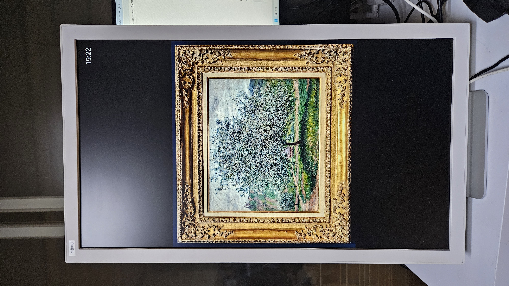

# EO1-Museum

> **Current version — EO1 Museum v0.41**
>
> EO1-Museum revives the discontinued **Electric Objects EO1** as a standalone digital museum display with a native Android application.
>
> The EO1 starts directly in **Local Gallery** mode and displays artwork stored in its internal storage. Exhibitions can be discovered, curated, and prepared on a PC, previewed through **PC Gallery**, and transferred to the EO1 over Wi-Fi using **Safe Sync**.
>
> Once synchronized, the EO1 operates independently without requiring the PC or a network connection for normal playback.
>
> The current workflow is:
>
> `artwork discovery → gallery preparation → PC Gallery → Safe Sync → Local Gallery`
>
> Safe Sync is controlled by the PC-side `server.py`. The EO1 verifies the server identity before syncing, respects configurable limits on media count and free storage space, and displays transfer progress on screen. Files are downloaded to temporary files before replacement so that an interrupted transfer does not destroy the existing Local Gallery.
>
> **v0.41** also adds selectable artwork display intervals of **15 seconds, 30 seconds, 1 minute, and 2 minutes**, while retaining the native Local Gallery / PC Gallery architecture introduced in earlier versions.
>
> The original Firefox + MetBoot browser-based architecture is no longer required for normal operation and is retained as a legacy installation method.

EO1-Museum brings an [Electric Objects EO1](https://www.kickstarter.com/projects/electricobjects/electric-objects-a-computer-made-for-art) back to life as a digital museum display. It combines a lightweight native Android application on the EO1 with PC-side tools for discovering, curating, preparing, and synchronizing artwork from open-access museum collections.

The project began with The Metropolitan Museum of Art collection and is designed to accommodate artworks from other open-access collections as well.

<p align="center">
  
</p>

<p align="center">
  <em>Claude Monet, The Apple Tree (Le Pommier), 1879. Museum Barberini, Potsdam (Hasso Plattner Collection).</em>
</p>

## Architecture: From Browser-Based Revival to Native EO1-Museum

EO1-Museum originally began as a **browser-based revival** of the Electric Objects EO1. The first working version used a PC to prepare and serve a web gallery, while the EO1 displayed that gallery through Firefox.

The original workflow was:

```text
Open-access museum collections
        ↓
Download and curate artworks on a PC
        ↓
Generate a local web gallery
        ↓
Serve the gallery over Wi-Fi
        ↓
Electric Objects EO1
        ↓
MetBoot launches Firefox automatically
        ↓
Firefox opens the local gallery
        ↓
Museum artworks are displayed on the EO1
```

Artwork collection, selection, image processing, and web serving were handled by a PC on the same local network. **Firefox 68.11.0** served as the gallery runtime on the EO1, while **MetBoot** automatically launched Firefox after Android booted. This provided the first stable, unattended EO1-Museum display without depending on the original Electric Objects service.

This browser-based architecture was later superseded by the native **EO1-Museum Android application**. The native application became the EO1's HOME application and introduced an independent **Local Gallery** using internal storage. The former PC-hosted gallery was then incorporated into the native application as **PC Gallery** through an embedded WebView.

Beginning with v0.4, **Safe Sync** connected these two modes by allowing exhibitions prepared on the PC to be transferred directly to the EO1 over Wi-Fi.

The current architecture is therefore:

```text
                 PC
                  │
        discovery / curation
                  │
           make_gallery.py
                  │
              display/
                  │
             server.py
                  │
        ┌─────────┴─────────┐
        │                   │
   PC Gallery           Safe Sync
   (WebView)                │
        │                   ▼
        │          EO1 internal storage
        │                   │
        └────────────► Local Gallery
                            │
                            ▼
                    independent playback
```

Once an exhibition has been synchronized, **Local Gallery does not require the PC or the network for normal playback**. The PC handles artwork discovery, curation, preparation, and synchronization; the EO1 primarily serves as the display device.

The complete development path—from the original browser-only experiment through Firefox and MetBoot, native Android development, ADBApprovalHelper, Local Gallery, PC Gallery, and Safe Sync—is documented in [EO1-Museum Development History](docs/DEVELOPMENT_HISTORY.md).

## Installation

The current installation procedure is described in the root-level [Installation Guide](INSTALL.md).

The guide provides two installation and maintenance paths:

1. **Network installation and normal operation** — the intended path for ordinary use. The native EO1-Museum APK is installed without relying on Firefox or MetBoot, and exhibitions are subsequently transferred through PC Gallery and Safe Sync.

2. **ADB installation and maintenance** — for users who want to install or update the APK directly over USB, transfer media with `adb push`, inspect the EO1 filesystem, troubleshoot the application, or perform development work. `ADBApprovalHelper` is documented as part of this path.

> **Important:** The simplified network installation procedure was reconstructed retrospectively from the development history and the author's current working EO1. It has **not yet been tested from beginning to end on a fresh or factory-reset EO1**. See [INSTALL.md](INSTALL.md) for the full warning and installation details.

Firefox and MetBoot are **not required for normal operation of the current native application**.

### Legacy Browser-Based Installation

The earlier Firefox + MetBoot installation procedure is preserved separately in [Legacy Installation Guide](legacy/INSTALL_LEGACY.md).

In that architecture, the EO1 required a Wi-Fi connection to the PC-hosted gallery during normal operation:

```text
Android boot
     ↓
MetBoot
     ↓
Firefox 68.11.0
     ↓
PC-hosted EO1-Museum gallery
```

The associated Windows batch files—`START_EO1.bat`, `UPDATE_MET.bat`, and `GET_MET_AND_START.bat`—also belong to this earlier browser-based workflow.

These files and instructions are retained for **historical reference and reproducibility**, rather than as the recommended setup for the current EO1-Museum application.

For the full history of this architecture and its transition to the native application, see [EO1-Museum Development History](docs/DEVELOPMENT_HISTORY.md).

## Museum Collections

EO1-Museum currently supports two primary sources for discovering open-access artworks: **The Metropolitan Museum of Art (The Met)** and **Wikimedia Commons**. Future versions may expand beyond conventional museum collections to include **space imagery provided by NASA** and **open-access collections from Korean museums and cultural institutions**. These additions are intended to broaden EO1-Museum from a museum-art display into a more flexible platform for exploring and presenting openly accessible visual culture and scientific imagery.

**The Met** provides a well-structured institutional collection with rich metadata. EO1-Museum can search its open-access collection using artist names, keywords, subjects, periods, cultures, and other metadata, making it particularly useful for systematic and curated discovery.

**Wikimedia Commons** provides a much broader pool of public-domain and freely reusable artwork images gathered from museums and cultural institutions around the world. EO1-Museum uses artist-based discovery, image-resolution filtering, license checks, and local metadata caching to identify suitable works. Because the collection is broader and less uniform than a single museum database, the workflow also supports human curation through persistent reject lists.

The two sources therefore complement each other:

```text
The Met
   └── structured, museum-based discovery

Wikimedia Commons
   └── broad, cross-collection discovery
```
Discovered artworks are downloaded to the PC, curated locally, and processed for the EO1's 1080 × 1920 portrait display. The resulting gallery can be viewed directly through PC Gallery or transferred to the EO1's internal storage using Safe Sync for independent Local Gallery playback.

Detailed search syntax, command-line options, examples, caching behavior, and curation workflows are documented separately in [Search Examples](SEARCH_EXAMPLES.md).

The discovery system is intentionally extensible, so additional open-access collections can be added when suitable image and metadata sources are available.

In this sense, EO1-Museum can also be seen as a small experiment in what might be called **“Fine Art Informatics”** — using open cultural data, metadata, computation, human curation, and digital displays to discover, organize, and experience works of art.

### Generative Art

EO1-Museum also supports **generative art** created with HTML5 Canvas and JavaScript. Because the EO1's original hardware is not powerful enough to render these animations smoothly in real time, the works are rendered on a PC as portrait-format MP4 video and played back by the native EO1-Museum application.

The artworks, interactive browser versions, and a brief description of the rendering workflow are available in the [Generative Art Gallery](https://jeong0449.github.io/EO1-Museum/art/).

## Inspiration and Prior Work

EO1-Museum builds on earlier work by **Darius Kazemi**, **Christian Boyle**, **spalt**, and **Charlie Harrington**, whose experiments, documentation, and source code demonstrated different ways to regain control of the Electric Objects EO1 and extend its useful life.

In particular, the native EO1 Museum application was developed by modifying and extending the EO1 Android source code preserved in [spalt/EO1](https://github.com/spalt/EO1). **Special thanks are due to spalt for preserving and sharing this source code**, which provided the practical foundation for the current native application.

For detailed discussion of these earlier projects and their influence on EO1-Museum, see [Inspiration and Prior Work](docs/PRIOR_WORK.md). The evolution of EO1-Museum itself is documented separately in [EO1-Museum Development History](docs/DEVELOPMENT_HISTORY.md).

## Future Development

EO1-Museum has evolved from an experimental workaround into a largely self-contained digital museum display. With the native Android gallery, fullscreen Local and PC Gallery modes, cross-fade transitions, automatic HOME startup, and PC-to-EO1 Safe Sync now implemented, several goals originally listed here have already been achieved.

Future development will therefore focus less on restoring basic EO1 functionality and more on improving **content discovery, curation, presentation, and gallery management**.

- **Artwork information** — optionally display the title, artist, date, medium, source collection, and other metadata together with each artwork.
- **Landscape artwork presentation** — provide a better way to display wide landscape-oriented works on the portrait EO1 screen, for example by slowly panning the image horizontally instead of shrinking the entire work to fit.
- **Exhibition and curation tools** — further develop workflows for creating themed exhibitions based on artists, periods, movements, cultures, subjects, or other metadata. Current tools already support artist- and keyword-based discovery, but more flexible curation remains possible.
- **Additional open-access collections** — extend artwork discovery beyond the Metropolitan Museum of Art and Wikimedia Commons when suitable museums or cultural institutions provide reusable high-quality images and metadata.
- **Local and personal collections** — make it easier to combine museum artworks with personal photographs or manually curated image collections within the same gallery workflow.
- **Richer collection metadata** — preserve more information about downloaded artworks throughout the pipeline from discovery to `original/`, `display/`, and ultimately the EO1, rather than treating the final gallery primarily as a collection of image files.
- **Improved Safe Sync** — continue testing PC-to-EO1 synchronization under interrupted Wi-Fi connections, limited storage, large collections, and other failure conditions, and refine collection replacement or mirroring behavior where useful.
- **Gallery configuration** — move selected parameters, such as image display duration, transition time, PC server address, and synchronization limits, into convenient configuration mechanisms without making the application unnecessarily complex.

Experimental work on Linux USB boot and extending the original Android environment with USB storage remains documented in [Experimental Linux USB Boot](docs/01_LINUX_USB_BOOT.md) and [Extending the Original Android Environment](docs/02_ANDROID_EXTENSIONS.md). These approaches are no longer required for normal EO1-Museum operation, since the native Android application and Safe Sync architecture now provide the essential functionality without replacing the original operating system.

The goal remains the same: not to turn the EO1 into a modern tablet, but to preserve its distinctive portrait display and give it a useful second life as a quiet, dedicated window into art.
