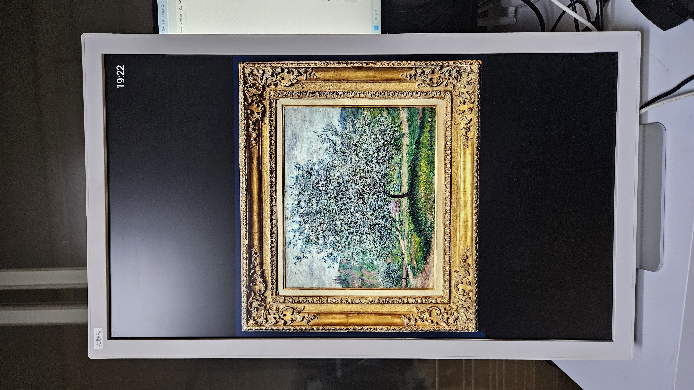

# EO1-Museum

> **Current version — EO1-Museum v0.42**

EO1-Museum brings the discontinued [Electric Objects EO1](https://www.kickstarter.com/projects/electricobjects/electric-objects-a-computer-made-for-art) back to life as a standalone digital art display for **curated open-access artworks and generative art**.

The project combines a lightweight native Android application on the EO1 with PC-side tools for discovering, curating, preparing, and synchronizing artwork. Once transferred to the EO1, collections can be displayed independently without a PC or network connection.

Artwork discovery currently draws on **The Metropolitan Museum of Art** and **Wikimedia Commons**, while generative artworks created with HTML and JavaScript are rendered as video for playback on the EO1.

  

  <em>Claude Monet, The Apple Tree (Le Pommier), 1879. Museum Barberini, Potsdam (Hasso Plattner Collection).</em>

## How It Works

EO1-Museum uses a PC for artwork discovery, curation, and gallery preparation. The prepared collection can either be viewed directly through **PC Gallery** or transferred over Wi-Fi using **Safe Sync** for independent playback from the EO1's internal storage.

    PC
     │
     ├── PC Gallery ──────────────► EO1
     │
     └── Safe Sync ───────────────► EO1
                                      │
                                Local Gallery
                                      │
                                      ▼
                             standalone playback

Once synchronized, Local Gallery does not require the PC or a network connection for normal playback.

Artwork files can also be copied directly to the EO1's internal storage using ADB for development or manual maintenance.

For the evolution from the original Firefox/MetBoot-based system to the current native application, see [Development History](docs/DEVELOPMENT_HISTORY.md).

## Installation

The current installation procedure is described in the root-level [Installation Guide](INSTALL.md).

The guide provides two installation and maintenance paths:

1. **Network installation and normal operation** — the intended path for ordinary use. The native EO1-Museum APK is installed without relying on Firefox or MetBoot, and exhibitions are subsequently transferred through PC Gallery and Safe Sync.

2. **ADB installation and maintenance** — for users who want to install or update the APK directly over USB, transfer media with `adb push`, inspect the EO1 filesystem, troubleshoot the application, or perform development work. `ADBApprovalHelper` is documented as part of this path.

> **Important:** The simplified network installation procedure was reconstructed retrospectively from the development history and the author's current working EO1. It has **not yet been tested from beginning to end on a fresh or factory-reset EO1**. See [INSTALL.md](INSTALL.md) for the full warning and installation details.

Firefox and MetBoot are **not required for normal operation of the current native application**.

### Legacy Browser-Based Installation

The earlier Firefox + MetBoot workflow is preserved in the [Legacy Installation Guide](legacy/INSTALL_LEGACY.md) for historical reference and reproducibility.

## Artwork and Collections

EO1-Museum displays both **curated open-access artworks** and **generative art**.

### Open-Access Collections

Artwork discovery and curation are handled on the PC using **Python tools included with EO1-Museum**. These tools currently support artwork discovery from **The Metropolitan Museum of Art** and **Wikimedia Commons**. The Met provides structured collection metadata, while Wikimedia Commons provides access to a much broader range of public-domain and freely reusable artwork from institutions around the world.

Selected artworks are downloaded and prepared on the PC for the EO1's 1080 × 1920 portrait display. The resulting collection can then be viewed through PC Gallery or transferred to the EO1 for independent playback in Local Gallery.

For search commands, filtering, caching, and curation workflows, see [Search Examples](SEARCH_EXAMPLES.md).

### Generative Art

EO1-Museum also supports **generative art** created with HTML5 Canvas and JavaScript. Because the EO1's original hardware is not powerful enough to render these animations smoothly in real time, the works are rendered on a PC as portrait-format MP4 video and played back by the native EO1-Museum application.

The artworks, interactive browser versions, and a brief description of the rendering workflow are available in the [Generative Art Gallery](https://jeong0449.github.io/EO1-Museum/art/).

In this sense, EO1-Museum can also be seen as a small experiment in what might be called **“Fine Art Informatics”** — using open cultural data, metadata, computation, human curation, and digital displays to discover, organize, and experience works of art.

## Inspiration and Prior Work

EO1-Museum builds on earlier work by **Darius Kazemi**, **Christian Boyle**, **spalt**, and **Charlie Harrington**, whose experiments, documentation, and source code demonstrated different ways to regain control of the Electric Objects EO1 and extend its useful life.

In particular, the native EO1 Museum application was developed by modifying and extending the EO1 Android source code preserved in [spalt/EO1](https://github.com/spalt/EO1). **Special thanks are due to spalt for preserving and sharing this source code**, which provided the practical foundation for the current native application.

For detailed discussion of these earlier projects and their influence on EO1-Museum, see [Inspiration and Prior Work](docs/PRIOR_WORK.md). The evolution of EO1-Museum itself is documented separately in [EO1-Museum Development History](docs/DEVELOPMENT_HISTORY.md).

## Documentation

- [Installation Guide](INSTALL.md) — installation, updates, and maintenance
- [Search Examples](SEARCH_EXAMPLES.md) — artwork discovery and curation
- [Development History](docs/DEVELOPMENT_HISTORY.md) — evolution of EO1-Museum
- [Inspiration and Prior Work](docs/PRIOR_WORK.md) — earlier EO1 revival projects
- [Roadmap](docs/ROADMAP.md) — planned improvements and future directions
- [Legacy Installation Guide](legacy/INSTALL_LEGACY.md) — Firefox/MetBoot-based installation

